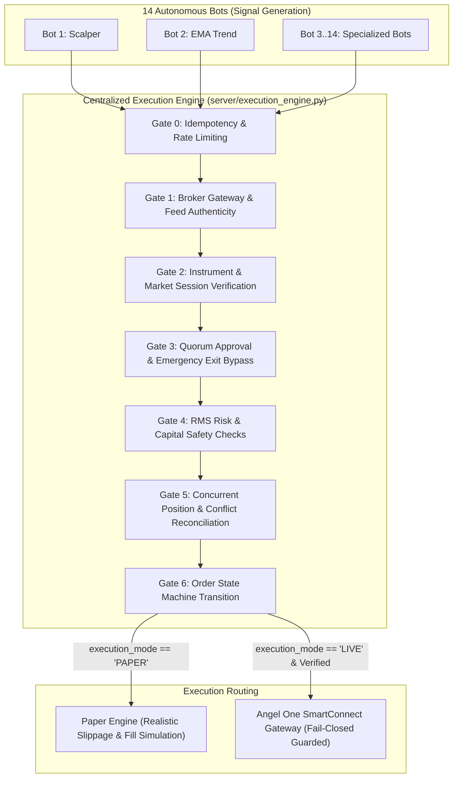
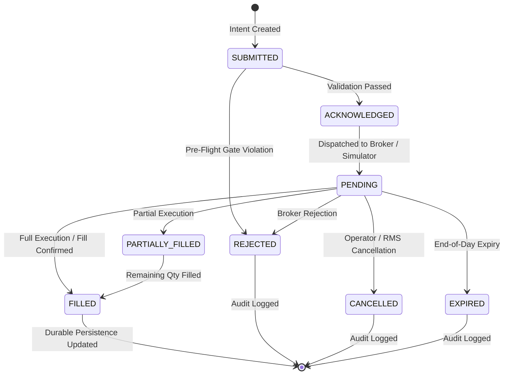

# CHINTU AI TRADING SYSTEM — CENTRALIZED EXECUTION ENGINE & RISK MANAGEMENT SPECIFICATION (PHASE 6)

**Document Version:** 1.0.0  
**Effective Date:** 2026-10-16  
**System Architecture:** CHINTU JARVIS CORE v2.3.0  
**Engine Module:** `server/execution_engine.py`  
**Execution Environment:** PAPER Mode (Fail-Closed Live Guard Enabled)  

---

## 1. Architectural Overview & Single-Gateway Invariant

The CHINTU AI Trading System deploys a centralized, single-gateway execution architecture for the shared Angel One SmartAPI broker account. 

### Fundamental Invariants:
1. **Zero Bot Independence for Broker Routing:** While all 14 algorithmic trading bots execute independent signal evaluations on their respective asset streams, **no individual bot is permitted to submit live orders directly to the broker**.
2. **Centralized Routing Gateway:** All order intents from bots, scheduler workers, or UI operators must route through `server.execution_engine.CentralizedExecutionEngine.execute_order(...)`.
3. **Fail-Closed Default:** If any safety check, feed authenticity check, quorum evaluation, rate limit, or position reconciliation fails, the order is rejected immediately before reaching the broker network socket.
4. **Permanent Paper Mode Invariant:** Real broker live orders remain strictly disabled throughout development and verification (`execution_mode = "PAPER"`).

---

## 2. The 6-Step Pre-Flight Validation Pipeline

Every order submitted to `CentralizedExecutionEngine.execute_order(...)` must traverse six sequential validation gates:

### Gate 0: Idempotency & Order Rate Limiter
- **Deterministic Client Order ID:** Generated via 64-bit truncated SHA-256 hash:
  $$\text{client\_order\_id} = \text{SHA256}(\text{bot\_id} \parallel \text{symbol} \parallel \text{action} \parallel \text{price} \parallel \lfloor\text{epoch}/5\rfloor)$$
- **Replay Protection:** Submissions with the same `client_order_id` within a 10-second window are rejected with `DUPLICATE_ORDER_REJECTED`.
- **API Rate Limiter:** Enforces a maximum of 15 orders per sliding 60-second window to protect broker API rate limits and avoid HTTP 429 throttling.

### Gate 1: Broker Connection & Authenticity Gate
- **Live Mode Gate:** Validates that `broker_state['angel_one']['connected'] == True` and active `SmartConnect` instance is non-null.
- **Feed Authenticity Gate:** Checks feed authenticity status. Rejects live orders if feed is simulated, unauthenticated, or stale ($> 10.0\text{s}$).
- **Reconciliation Check:** Rejects live entry orders if reconciliation status is `MISMATCH`, `FAILED`, or `NOT_VERIFIED`.

### Gate 2: Instrument Parameter & Market Session Gate
- **Symbol & Exchange Mapping:** Resolves canonical instruments against `ANGEL_SYMBOL_MAP` (e.g., `"NIFTY 50"` $\rightarrow$ `NIFTY24OCTFUT`, `symboltoken: 42125`, `exchange: NFO`, `lotsize: 50`).
- **Parameter Validation:** Enforces non-empty symbol strings, positive integer quantities, valid lot-size multiples, and recognized product types (`INTRADAY` or `NORMAL`).
- **Market Session Gate:** Enforces statutory exchange trading windows:
  - **NSE / BSE / NFO:** 09:15 to 15:30 IST (Monday through Friday).
  - **MCX Commodities:** 09:00 to 23:30 / 23:55 IST.
  - Off-market orders are blocked unless `enforce_market_hours = False` (configured for off-market paper/test simulations).

### Gate 3: Majority Approval & Emergency Exit Bypass Gate
- **Quorum Handshake:** Evaluates peer mesh consensus via `server.voting_engine.evaluate_order_quorum(...)`.
- **Configurable Threshold:** Requires quorum compliance (default $\ge 66.6\%$ approval among fresh, eligible voters).
- **CRITICAL EXCEPTION — Emergency Exit Bypass:** Risk-reducing exits (`action in ['EXIT', 'SQUAREOFF']` or closing an opposite open position) **unconditionally bypass entry quorum**. No peer veto can block a capital-protecting stop loss or square-off.

### Gate 4: RMS Risk & Capital Safety Gate
- **RMS Circuit Breaker:** If `circuit_breaker_active == True`, all new entry orders are emergency blocked.
- **Max Daily Loss Limit:** Real-time realized daily P&L is checked against `max_daily_loss` (default ₹2,000.00). If breached, the circuit breaker trips, logs an RMS event to SQLite, and halts all entries.
- **Max Capital Per Bot / Margin Calculation:** Evaluates margin requirement based on asset class:
  - **F&O Futures:** $\approx 12\%$ SPAN + Exposure margin on contract turnover.
  - **Equity Intraday:** $\approx 20\%$ margin ($5\times$ regulatory intraday leverage).
  - **Options:** $100\%$ premium value ($\text{price} \times \text{qty}$).
  - Blocks orders where required margin exceeds `max_capital_per_bot`.

### Gate 5: Position Conflict & Concurrent Order Check
- **Max Open Positions:** Limits simultaneous open positions across all bots (default $\le 5$).
- **Position Duplication & Conflict Prevention:**
  - If a `LONG` position is already active on a symbol and another `BUY` intent arrives, it is rejected as a duplicate position conflict.
  - If a `SHORT` position is active and a `BUY` arrives, it is routed as an exit/square-off rather than opening conflicting parallel positions.

### Gate 6: State Machine Transition & Execution
- Upon clearing Gates 0–5, the order transitions into the authoritative lifecycle state machine.

---

## 3. Order Lifecycle State Machine

The CHINTU order state machine governs every order transition cleanly without ambiguity:

### State Definitions:
| State | Description | Persistence Action |
| :--- | :--- | :--- |
| **`SUBMITTED`** | Initial client intent received by Centralized Execution Engine. | In-memory validation. |
| **`ACKNOWLEDGED`**| Passed all 6 pre-flight validation gates. | Logged to `orders_memory` as `PENDING`. |
| **`PENDING`** | Order sent to Angel One SmartAPI or paper fill simulator. | Awaits fill confirmation or broker reject. |
| **`FILLED`** | Executed in full. | Updates `orders_memory`, opens/closes `positions_memory`, logs `trade_memory`. |
| **`PARTIALLY_FILLED`** | Partially executed by broker matching engine. | Increments `filled_qty`, updates `avg_price`. |
| **`CANCELLED`** | Cancelled before fill by operator, bot exit, or RMS timeout. | Updates `orders_memory` status to `CANCELLED`. |
| **`REJECTED`** | Rejected by pre-flight gates or broker API. | Updates `orders_memory` with `rejection_reason`. |
| **`EXPIRED`** | Unfilled intraday order expired at market close ($15:30$ IST). | Marked `EXPIRED` in `orders_memory`. |

---

## 4. Paper Simulation vs Live Execution Routing

### PAPER Mode Behavior:
1. **Realistic Execution Price:** Execution prices are not filled at exact theoretical signals; a volatility-aware slippage penalty is applied ($+0.03\%$ on buys, $-0.03\%$ on sells for liquid indices).
2. **Deterministic State Transitions:** Transitions immediately from `SUBMITTED` $\rightarrow$ `ACKNOWLEDGED` $\rightarrow$ `PENDING` $\rightarrow$ `FILLED` (or `REJECTED`).
3. **Durable Persistence:** Writes order record to SQLite `orders_memory`, updates `positions_memory` with `pos_key = f"{bot}_{symbol}"`, mark-to-market LTP, and records trade to `trade_memory`.

### LIVE Mode Behavior (Angel One SmartAPI):
1. **Credentials & Token Sanity:** Calls `SmartConnect.placeOrder()` using authenticated session JWT.
2. **Parameter Serialization:** Formats parameters according to official SmartAPI v2 specification (`variety: "NORMAL"`, `transactiontype`, `tradingsymbol`, `symboltoken`, `ordertype`, `producttype: "INTRADAY"`, `duration: "DAY"`).
3. **Asynchronous Order Tracking:** Parses broker `orderid`, tracks execution in order book, and verifies fill status.
4. **Immediate Reconciliation:** Triggers `reconcile_positions_with_broker()` after every live fill event.

---

## 5. Broker Position Reconciliation & Circuit Breakers

The broker reconciliation subsystem guarantees that local portfolio state never diverges from the broker's clearinghouse book:

1. **Periodic Reconciliation:** Executes every 60 seconds during active trading hours.
2. **Event-Driven Reconciliation:** Executes immediately following any `FILLED` or `CANCELLED` order event.
3. **Discrepancy Detection:** Compares open positions in `positions_memory` against SmartAPI `getPosition()` response:
   - Symbol match.
   - Net quantity match ($\text{Broker Qty} == \text{Local Qty}$).
   - Position side match (`LONG` vs `SHORT`).
4. **Fail-Closed Mismatch Action:**
   - If an unhedged or unrecognized position exists on the broker side, or if local quantities exceed broker quantities:
   - Sets `reconciliation_state['status'] = "MISMATCH"`.
   - Sets `reconciliation_state['block_live_entries'] = True`.
   - Dispatches emergency alert to Telegram / WhatsApp.
   - New live entry orders are strictly blocked until manual administrative reconciliation is completed.

---

## 6. Verification & Test Evidence

The execution engine implementation has been verified through automated deterministic testing in `tests/test_execution_engine.py`:

- `test_idempotent_order_id_generation`: **PASS** (Deterministic SHA-256 generation).
- `test_duplicate_order_rejection_via_idempotency`: **PASS** (Rejects rapid identical clientOrderId).
- `test_rate_limiting_enforcement`: **PASS** (Rejects order submissions exceeding sliding window).
- `test_invalid_parameters_rejection`: **PASS** (Rejects empty symbols and zero/negative quantities).
- `test_emergency_exit_bypasses_circuit_breaker`: **PASS** (Emergency exits successfully bypass tripped circuit breaker).
- `test_rms_daily_loss_limit_trips_breaker`: **PASS** (Breached loss limit automatically arms circuit breaker).
- `test_live_order_blocked_when_unauthenticated`: **PASS** (Unauthenticated live requests fail-closed).
- `test_live_order_blocked_when_reconciliation_mismatch`: **PASS** (Reconciliation mismatch halts live entry routing).
- `test_paper_execution_state_machine_and_position_lifecycle`: **PASS** (Full entry, fill, position save, square-off, and trade recording verified).

---

## 7. Next Steps

With Phase 6 complete, proceed to:
1. **Phase 7:** Authentic Angel One Integration Hardening (WebSocket reconnection, quote polling, sanitized credential validation).
2. **Phase 8:** Safe Live-Readiness Gate (`server/live_readiness_gate.py` asserting all 8 pre-flight release conditions before LIVE mode unlock).

