# CHINTU AI TRADING SYSTEM — SHARED STRATEGY LIBRARY, COPY-PASTE IMPORTER & SCANNER VERIFICATION REPORT

**Date:** 2026-10-17  
**System Version:** v2.4.0-enterprise  
**Lead Quantitative Architect:** Veeresh (Master Authority)  
**Execution Mode Invariant:** `PAPER` (Real broker order submissions locked)  
**Pytest Status:** **205 / 205 PASS (100%)**  
**Vite Production Build:** **PASS (1.75s)**  

---

## 1. Executive Summary

This report documents the architectural implementation and end-to-end verification of the **Shared Strategy Library**, **AST-Sandboxed Copy-Paste Strategy Importer**, and **Strategy Scanner & Analysis Service** for the CHINTU AI Trading System.

All 14 canonical trading bots now connect to an authoritative, versioned SQLite repository (`chintu_memory.db`) that serves as the single source of truth for quantitative trading strategies. The implementation strictly adheres to all core project constraints:
1. **Zero Bot Proliferation:** Strictly preserves all 14 existing bots (IDs 1–14). No extra trading bots were created.
2. **Zero Unrestricted Exec/Eval:** Untrusted strategy code pasted by operators is statically analyzed via Python's `ast` module. Dangerous imports, built-in calls (`open`, `eval`, `exec`, `globals`, `locals`), and private dunder attributes (`__class__`, `__subclasses__`) are blocked with exact line-number security errors.
3. **Immutable Versioning & Rollback:** Every strategy maintains an append-only version history (`v1.0.0`, `v1.1.0`...) and an immutable audit trail. Active versions can be hot-swapped or rolled back across running bots in real-time.
4. **Quorum Independence & Anti-Sybil Clustering:** The Strategy Scanner detects structural indicator correlation across strategies in the voting pool, preventing duplicate or highly correlated models from inflating the Majority Voting Quorum.
5. **Deterministic Fail-Closed Operation:** Strategies requiring specialized feeds (such as Bot 12's Option Chain Greeks or Bot 13's Footprint Depth) strictly fail closed with `DATA_UNAVAILABLE` and `NO_TRADE` when authentic market data is absent.

---

## 2. Architecture & Data Flow

```mermaid
flowchart TD
    subgraph UI ["Frontend React / Vite Dashboard"]
        LibView["Strategy Library View"]
        Importer["Copy-Paste Importer (AST Live Validator)"]
        ScannerModal["Strategy Scanner & Quorum Independence"]
        DetailsDrawer["Version History & Bot Deployment Drawer"]
    end

    subgraph Backend ["FastAPI Core Services"]
        LibAPI["/api/strategies/library"]
        ValAPI["/api/strategies/validate"]
        ScanAPI["/api/strategies/scanner/scan"]
        AllocAPI["/api/strategies/bot-allocations"]
    end

    subgraph Security ["AST Security Sandbox"]
        ASTVisitor["AST Security Visitor (Blocks os/sys/eval/dunders)"]
        DryRunEngine["Restricted Sandboxed Dry-Run Evaluator"]
        LeakageDetector["Temporal Look-Ahead & Leakage Detector"]
    end

    subgraph Storage ["SQLite3 Durable Persistence (WAL Mode)"]
        StratLibTable[("strategy_library")]
        StratVerTable[("strategy_versions (Immutable)")]
        StratAllocTable[("strategy_bot_allocations")]
        StratAuditTable[("strategy_audit_trail")]
    end

    subgraph BotMesh ["14 Autonomous Bot Workers"]
        B1["Bot 1: Scalper (1m)"]
        B2["Bot 2: EMA Trend (5m)"]
        B3["Bot 3: RSI Reversal (15m)"]
        B_others["Bots 4-14 (Equities, Commodities, Options)"]
    end

    UI --> Backend
    Backend --> Security
    Security --> Storage
    Storage --> BotMesh
```



---

## 3. Database Schema & Persistence

The SQLite persistence layer in `server/memory_db.py` was extended with four dedicated relational tables and indexes:

### 3.1 `strategy_library`
Stores core strategy metadata, active version pointer, status, and classification.
- `id` (TEXT PRIMARY KEY)
- `name` (TEXT NOT NULL)
- `category` (TEXT NOT NULL)
- `description` (TEXT)
- `author` (TEXT DEFAULT 'Veeresh')
- `source_format` (TEXT: `STRUCTURED`, `JSON`, `PYTHON`)
- `active_version` (TEXT DEFAULT 'v1.0.0')
- `status` (TEXT: `Draft`, `Validation Failed`, `Backtest Pending`, `Approved`, `Published`, `Archived`)
- `risk_classification` (TEXT: `Conservative`, `Moderate`, `Aggressive`)
- `timeframe` (TEXT DEFAULT '5m')
- `supported_instruments` (JSON Array)
- `content_hash` (TEXT SHA-256)
- `created_at`, `updated_at` (ISO-8601 Timestamps)

### 3.2 `strategy_versions`
Stores immutable snapshot definitions for every version iteration.
- `id` (INTEGER PRIMARY KEY AUTOINCREMENT)
- `strategy_id` (TEXT NOT NULL)
- `version` (TEXT NOT NULL e.g. `v1.0.0`)
- `raw_source` (TEXT NOT NULL: raw code or JSON schema)
- `source_format` (TEXT: `PYTHON`, `JSON`, `STRUCTURED`)
- `normalized_definition` (JSON representation)
- `entry_rules`, `exit_rules` (TEXT)
- `indicators`, `parameters`, `risk_limits` (JSON)
- `validation_report` (JSON report with score and issues)
- `approval_status` (TEXT: `Draft`, `Approved`, `Rejected`)
- `change_summary` (TEXT)
- `created_by`, `created_at` (TEXT)
- `UNIQUE(strategy_id, version)`

### 3.3 `strategy_bot_allocations`
Maps individual bots (IDs 1–14) to their active strategy version.
- `bot_id` (INTEGER NOT NULL UNIQUE)
- `strategy_id` (TEXT NOT NULL)
- `version` (TEXT NOT NULL)
- `is_active` (INTEGER DEFAULT 1)
- `allocated_by`, `allocated_at`, `notes` (TEXT)

### 3.4 `strategy_audit_trail`
Append-only immutable record of all lifecycle events (`CREATED`, `UPDATED`, `VERSION_CREATED`, `VALIDATED`, `APPROVED`, `PUBLISHED`, `ROLLBACK`, `ARCHIVED`, `DUPLICATED`).

---

## 4. AST Security & Sandboxing (`server/strategy_validator.py`)

Untrusted user-supplied code is subject to multi-layered static and dynamic security:

| Check Category | Rule Enforced | Action on Violation |
| :--- | :--- | :--- |
| **Import Whitelisting** | Disallow `os`, `sys`, `subprocess`, `socket`, `shutil`, `urllib`, `requests`, `pickle`, `ctypes`, `importlib`. Allow only `math` and `typing`. | Rejection with line number & module name |
| **Dangerous Builtins** | Disallow `open`, `eval`, `exec`, `compile`, `__import__`, `globals`, `locals`, `getattr`, `setattr`, `vars`, `breakpoint`, `exit`. | Rejection with line number & function name |
| **Sandbox Escape** | Disallow access to private dunder attributes (`__class__`, `__subclasses__`, `__globals__`, `__code__`). | Immediate AST parse rejection |
| **Temporal Leakage** | Detect positive forward candle indexing (e.g. `candles[i + 1]`, `shift(-1)`, `future_close`). | Warning & quality penalty |
| **Sandboxed Dry-Run** | Compiles code into a restricted execution dictionary containing only safe mathematical builtins and technical indicator calculation primitives. Invokes `evaluate()` with 50 synthetic candles. | Verifies return structure has valid `decision` in `[BUY, SELL, HOLD, EXIT, NO_TRADE]`. |

---

## 5. Quantitative Strategy Scanner & Anti-Sybil Engine (`server/strategy_scanner.py`)

The Strategy Scanner provides continuous quantitative health verification across all saved strategies:

1. **Transaction Drag Analysis:**
   Computes round-trip regulatory friction under Indian market costs (STT, NSE turnover charges, 18% GST, SEBI turnover fees, stamp duty, and execution slippage). Warns if transaction friction consumes $> 25\%$ of the strategy's target profit.
2. **Specialized Data Dependency Audit:**
   Identifies strategies requiring derivatives feeds (Option Chain Greeks, L3 Footprint Depth, Multi-Index Covariance) and flags whether the active market data connection supports them.
3. **Correlation Cluster & Anti-Sybil Quorum Detection:**
   Calculates pairwise Jaccard similarity across technical indicators, timeframes, and market categories. If two strategies with $> 65\%$ structural similarity are concurrently allocated to bots voting in the Majority Voting Quorum, an alert is raised to prevent quorum manipulation.

---

## 6. Multi-Bot Shared Connection & Immutability

The 14 canonical bots seamlessly consume strategies from the shared repository:
- **Zero In-Memory Drift:** Bot worker threads never mutate shared strategy definitions. Execution is parameterized by the immutable version referenced in `strategy_bot_allocations`.
- **Dynamic Hot-Swapping:** An operator can publish an approved strategy version to any eligible bot with 1 click; the bot immediately evaluates incoming ticks under the new version rules.
- **Fail-Safe Fallback:** If a custom strategy is archived or deactivated, the bot automatically reverts to its canonical quantitative strategy without service interruption.
- **Traceable Signal Metadata:** Every generated signal dictionary includes `strategy_id` and `strategy_version` (e.g. `v1.0.0`), linking executed paper trades to the exact strategy version that fired them.

---

## 7. Frontend User Experience (`StrategyLibraryView.jsx`)

The newly implemented React view provides a high-density cybernetic dashboard matching CHINTU AI's design language:
- **Top KPI Metrics Strip:** Total Strategies, Active on Bots, Published Quorum, Quorum Independence.
- **Search & Multi-Dimensional Filters:** Real-time text search, Status filter (`Published`, `Approved`, `Draft`, `Archived`), and Timeframe filter (`1m`, `3m`, `5m`, `15m`).
- **Strategy Cards:** Displays active version, category, supported instruments, risk bounds (SL% / Target%), and allocated bot count. Action buttons for View Details, Duplicate, Archive.
- **Copy-Paste Strategy Importer Modal:** Includes quick presets (SuperTrend Scalper, Triple EMA Trend Rider, RSI Reversal, ORB Breakout), syntax format selector, live "Validate Syntax & AST Safety" button, and dynamic error/warning banner.
- **Strategy Details Drawer:** 4-tab slide-over panel for Rules & Indicators, Version History with 1-click Rollback, Interactive Bot Deployments (1–14), and Audit Trail.
- **Strategy Scanner & Quorum Report Modal:** Visualizes overall repository health scores, friction drag, and anti-sybil cluster verification.

---

## 8. Verification & Test Evidence

### 8.1 Automated Pytest Suite (205 Tests)
```text
tests\test_backtest_and_research.py ..........                           [  4%]
tests\test_emergency_exit_and_rms.py ......                              [  7%]
tests\test_execution_engine.py .........                                 [ 12%]
tests\test_live_readiness_gate.py ......                                 [ 15%]
tests\test_market_feed_security.py ..........                            [ 20%]
tests\test_master_bot_multi_factor.py .............                      [ 26%]
tests\test_phase10_authentic_feed_verification.py ...........            [ 31%]
tests\test_phase7_pipeline_remediation.py ..............                 [ 38%]
tests\test_phase8_validation.py ..................                       [ 47%]
tests\test_position_persistence_and_reconciliation.py .........          [ 51%]
tests\test_shared_bot_strategy_integration.py ....                       [ 53%]
tests\test_strategy_engine_and_bot_scheduler.py ........................ [ 65%]
.............                                                            [ 71%]
tests\test_strategy_library.py ..........                                [ 76%]
tests\test_strategy_scanner.py ...                                       [ 78%]
tests\test_strategy_validator.py ...........                             [ 83%]
tests\test_system_integrity.py .........                                 [ 87%]
tests\test_telemetry_and_operational_controls.py ........                [ 91%]
tests\test_trading_bot_connectivity_audit.py ........                    [ 95%]
tests\test_voting_engine.py .........                                    [100%]

====================== 205 passed, 10 warnings in 8.40s =======================
```

### 8.2 Frontend Production Build
```text
> new@0.0.0 build
> vite build

vite v8.3.4 building client environment for production...
transforming...
✓ 1952 modules transformed.
rendering chunks...
dist/index.html                   2.30 kB │ gzip:   1.10 kB
dist/assets/index-B-AxuslM.css   82.28 kB │ gzip:  11.77 kB
dist/assets/index-0hXjZfk0.js   895.03 kB │ gzip: 221.44 kB
✓ built in 1.75s
```

---

## 9. Conclusion & Release Status

The Shared Strategy Library, Copy-Paste Importer, and Strategy Scanner have been fully implemented, verified, and hardened.
- **Readiness Status:** **VERIFIED & OPERATIONAL**
- **Safety Mode:** Strictly preserved in `PAPER` mode. Real broker orders remain locked.
- **Regressions:** Zero regressions across all 14 bots, majority voting engine, execution gateway, and risk management system.

