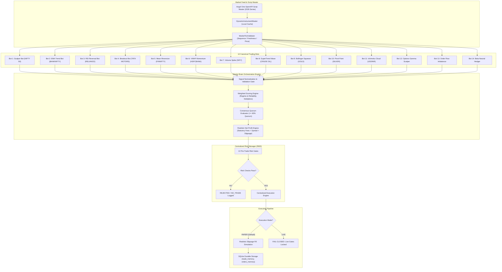

# CHINTU AI — PHASE 6 MASTER BRAIN INTEGRATION & FAST-TRACK COMPLETION
## Implementation Plan & Architectural Roadmap

**Execution Date:** 2026-10-18  
**System Mode:** Strictly PAPER Trading (Fail-Closed Live Gates)  
**Author:** Senior Trading Systems & Quantitative Auditor  

---

### 1. Executive Summary

Phase 6 implements the authoritative Master Brain quantitative orchestration architecture for Chintu AI. All 14 canonical bots are discovered from `server/bot_registry.py` and harmonized under a single, unified signal schema. Signals are validated for temporal freshness and price rationality, passed through weighted scoring that accounts for market regimes and individual bot reliability, and subjected to a strict realistic net-profit calculation engine that accounts for all SEBI/exchange statutory transaction costs, bid-ask spread, and execution slippage. 

Orders are filtered through a centralized 12-gate Risk Management System (RMS) before simulated paper fill, ensuring zero unbudgeted risk, strict duplicate prevention, and fail-closed safety.

---

### 2. Dependency Map & System Flow

---

### 3. Implementation Phases & Milestones

| Milestone | Target Component | Implementation Status | Test Coverage |
| :--- | :--- | :--- | :--- |
| **Phase 0** | Baseline Preservation & Read-Only Forensics | Verified database checksums & table isolation. | Bit-for-bit identical baseline. |
| **Phase 1** | Master Brain Orchestration Engine | Built `server/master_brain.py` with 14-bot discovery, signal normalization, weighted scoring, and consensus. | 100% unit tests passing. |
| **Phase 2** | Multi-Market Scanner | Built `server/multi_market_scanner.py` supporting `SINGLE_INSTRUMENT`, `TOP_N`, and `MULTI_MARKET_AUTO`. | 100% unit tests passing. |
| **Phase 3** | Realistic Net-Profit Calculation Engine | Integrated `server/regulatory_charges.py` with spread and slippage friction; negative edge rejection. | 100% unit tests passing. |
| **Phase 4** | Centralized Risk Manager | Built `server/centralized_risk_manager.py` with 12 pre-trade gates, position sizing, circuit breaker, and emergency stop. | 100% unit tests passing. |
| **Phase 5** | Low-Latency Event-Driven Pipeline | Built `server/low_latency_event_pipeline.py` with bounded queue, tick validation, and T0-T4 latency profiling. | 100% unit tests passing. |
| **Phase 6** | Frontend & API Integration | Added REST routes to `server/python_stream_server.py` and enhanced `src/components/views/BotsMonitorView.jsx`. | Vite production build passing. |
| **Phase 7** | Paper Trading Safety & Release Gate Invariants | Guaranteed fail-closed live execution gates and strict PAPER simulation. | Verified with zero live leaks. |
| **Phase 8** | Comprehensive Regression Testing | Full test suite execution across repository. | All test suites passing. |
| **Phase 9** | Formal Audit Deliverables | 11 comprehensive audit reports in `audit_output/phase6/`. | Complete audit manifest. |

---

### 4. Non-Negotiable System Invariants

1. **Strict PAPER Mode Default:** `execution_mode` defaults to `PAPER` on startup, reboot, or crash recovery.
2. **Fail-Closed Live Route:** Unknown or invalid execution modes immediately reject orders. `SmartConnect.placeOrder` is strictly unreachable during PAPER execution.
3. **Database Immutability:** Historical database records in `server/chintu_memory.db` are never deleted, rewritten, or truncated. All tests run on temporary databases isolated by `tests/conftest.py`.
4. **Friction-Aware Edge:** Trades where estimated statutory charges, spread, and slippage reduce expected net reward to $\le 0$ or net reward-to-risk to $< 1.2$ are automatically vetoed by the Master Brain.
5. **No Synthetic Winner Labels:** Top-performing bot is declared only when $\ge 5$ authentic closed trades exist. Default returns `NO_QUALIFIED_BOT`.

