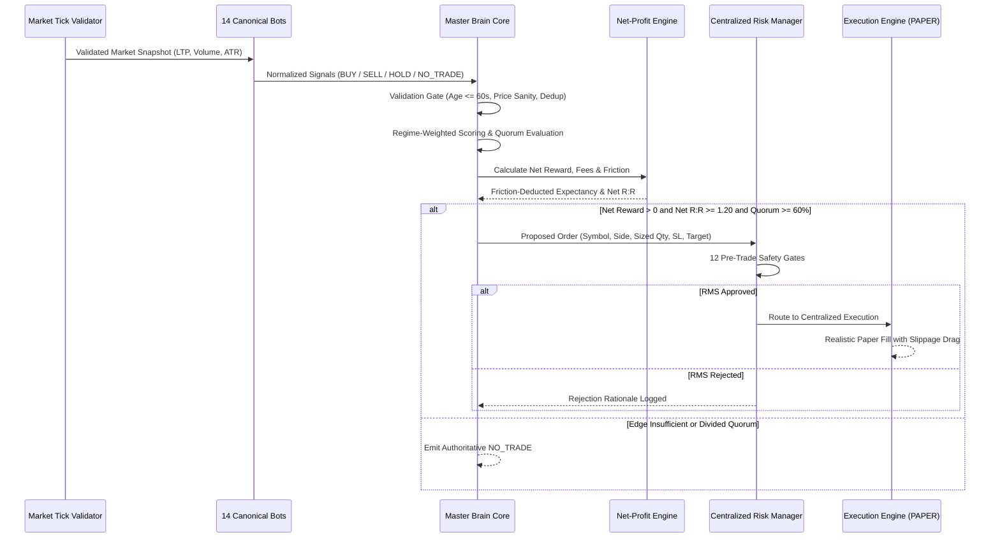

# CHINTU AI — PHASE 6 MASTER BRAIN ARCHITECTURE
## Quantitative Intelligence, Multi-Bot Consensus & Signal Harmonization

**Audit Date:** 2026-10-18  
**Architecture Version:** Master Brain 2.0  
**Target Fleet:** 14 Canonical Autonomous Trading Bots  

---

### 1. Architectural Overview

The Master Brain is the centralized quantitative decision hub for Chintu AI. Rather than allowing individual bots to trade autonomously without portfolio awareness, the Master Brain coordinates all 14 bots through a 4-layer quantitative pipeline:



---

### 2. Fleet Discovery & Signal Schema Normalization

The Master Brain auto-discovers all 14 bots directly from `CANONICAL_BOT_REGISTRY` in `server/bot_registry.py`. Every bot output is normalized into this authoritative schema:

```python
{
    "bot_id": int,              # 1 to 14
    "bot_name": str,            # Canonical bot label
    "symbol": str,              # Exchange tradingsymbol or canonical asset name
    "action": str,              # BUY, SELL, HOLD, NO_TRADE
    "confidence": float,        # Calibrated model confidence (0.0 to 1.0)
    "risk_estimate": float,     # Strategy risk factor (0.0 to 1.0)
    "entry": float,             # Proposed entry price
    "stop_loss": float,         # Proposed stop-loss price
    "target": float,            # Proposed profit target price
    "expected_holding": str,    # e.g., "1m", "5m", "15m"
    "reason": str,              # Mathematical indicator rationale
    "timestamp": str,           # ISO-8601 UTC/IST timestamp
    "timeframe": str,           # Strategy timeframe
    "strategy_id": str,         # Strategy identifier
    "strategy_name": str,       # Descriptive strategy name
    "lotsize": int              # Exchange lot multiplier
}
```

---

### 3. Quantitative Weighted Consensus Algorithm

The Master Brain does not use naive equal-weighted majority voting. Instead, every contributing bot's vote is dynamically weighted by its historical parameters, market regime alignment, and signal confidence:

$$\text{Effective Weight } (W_i) = w_{base} \times M_{regime} \times (1.0 - 0.6 \times \text{risk\_estimate}) \times \text{confidence}$$

Where:
- $w_{base}$: Canonical bot weight from registry (1.00 to 1.25)
- $M_{regime}$: Market regime alignment multiplier:
  - In `TRENDING_BULL` or `TRENDING_BEAR`: Trend bots (Bots 1, 2, 6, 8) receive a **1.25x boost**, while mean-reversion bots (Bots 3, 5, 10) are penalized at **0.80x**.
  - In `RANGING` / `SIDEWAYS`: Mean-reversion bots receive a **1.25x boost**, while trend bots are reduced to **0.80x**.
  - In `HIGH_VOLATILITY`: Breakout and volatility squeeze bots (Bots 4, 9, 11) receive a **1.20x boost**.
- Consensus Quorum Requirement:
  $$\text{Quorum Ratio } (Q_{BUY}) = \frac{\sum_{i \in BUY} W_i}{\sum_{all} W_i} \ge 0.60 \quad (60\% \text{ weighted consensus})$$

If neither BUY nor SELL achieves $\ge 60\%$ quorum, the Master Brain returns an explicit `NO_TRADE` decision with full diagnostic logging.

---

### 4. Conflict & Position Protection Invariants

1. **Duplicate Position Safeguard:** If an active position for the same symbol in the same direction exists in `positions_memory`, new entry proposals are immediately blocked and converted to `NO_TRADE`.
2. **Opposing Order Reconciliation:** If an opposing signal arrives (e.g. SELL signal when LONG position is open), the execution engine treats it as a position square-off/exit rather than opening concurrent opposing legs.
3. **Emergency Exit Fast-Path:** Risk-reducing exits and emergency square-offs bypass the 60% entry consensus requirement to ensure immediate risk mitigation.

