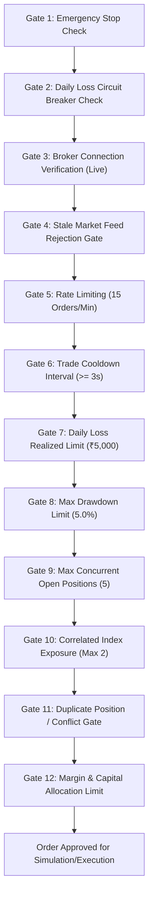

# CHINTU AI — PHASE 6 CENTRALIZED RISK & SAFETY REPORT
## 12 Pre-Trade Safety Gates, Circuit Breakers, Position Sizing & Emergency Procedures

**Audit Date:** 2026-10-18  
**Component:** `server/centralized_risk_manager.py`  
**Scope:** Shared Portfolio-Wide RMS Across All 14 Bots  

---

### 1. The 12 Centralized Pre-Trade Risk Gates

Every proposed order from any bot, API endpoint, or automated sweep must pass through all 12 sequential safety gates before reaching execution:

---

### 2. Detailed Gate Specifications

| Gate # | Gate Name | Configuration Limit | Failure Action | Bypass Permitted? |
| :--- | :--- | :--- | :--- | :--- |
| **Gate 1** | Emergency Stop System | System-wide state | Fails closed; blocks all entry orders | Risk-reducing exits only |
| **Gate 2** | Circuit Breaker State | System-wide state | Fails closed; blocks all entry orders | Risk-reducing exits only |
| **Gate 3** | Broker Connection (Live) | Active SmartConnect session | Blocks live execution; switches to PAPER | None |
| **Gate 4** | Stale Feed Gate | Tick age $\le 60.0$ seconds | Rejects order (`STALE_MARKET_FEED`) | Risk-reducing exits only |
| **Gate 5** | Rate Limiter | $\le 15$ orders per 60 seconds | Rejects order (`RATE_LIMIT_EXCEEDED`) | Risk-reducing exits only |
| **Gate 6** | Order Cooldown | $\ge 3.0$ seconds between orders | Rejects order (`ORDER_COOLDOWN_ACTIVE`) | Risk-reducing exits only |
| **Gate 7** | Daily Loss Limit | Realized loss $\ge -₹5,000.00$ | **Trips Circuit Breaker**; locks entries | None |
| **Gate 8** | Trailing Drawdown | Max 5.0% from peak equity | **Trips Circuit Breaker**; locks entries | None |
| **Gate 9** | Max Open Positions | Max 5 concurrent positions | Rejects order (`MAX_POSITIONS_REACHED`) | Position closing orders |
| **Gate 10** | Correlated Exposure | Max 2 index derivative positions | Rejects order (`CORRELATED_EXPOSURE_LIMIT`) | None |
| **Gate 11** | Duplicate / Conflict | No duplicate side entries | Rejects order (`DUPLICATE_POSITION_EXISTS`) | Exits |
| **Gate 12** | Margin Allocation | Margin $\le ₹50,000$ per bot | Rejects order (`MARGIN_EXCEEDS_BOT_CAPITAL`) | None |

---

### 3. Stop-Loss Position Sizing Formula

The RMS computes position sizes dynamically based on the exact stop-loss distance to ensure no trade risks more than $1.5\%$ of account capital:

$$\text{Risk Budget} = \text{Account Capital} \times \text{Max Risk Pct} = ₹200,000 \times 1.5\% = ₹3,000.00$$
$$\text{Max Lots} = \left\lfloor \frac{\text{Risk Budget}}{|\text{Entry} - \text{StopLoss}| \times \text{Lotsize}} \right\rfloor$$
$$\text{Approved Quantity} = \max(1, \text{Max Lots}) \times \text{Lotsize}$$

---

### 4. Emergency Stop & Safe Position Cancellation Procedures

1. **Triggering Emergency Stop:** Can be triggered via `/api/rms/emergency-stop`, the frontend UI STOP RMS button, or automated catastrophic anomaly detection.
2. **Behavior on Trigger:**
   - Immediately sets `emergency_stop_active = True` and `circuit_breaker_active = True`.
   - Rejects all subsequent BUY/SELL entry orders.
   - Authorizes immediate risk-reducing square-offs (`is_emergency_exit = True`).
   - Cancels all pending unfilled limit orders.
3. **Resetting Emergency Stop:** Requires verified administrator override via `/api/rms/reset-circuit-breaker`.

