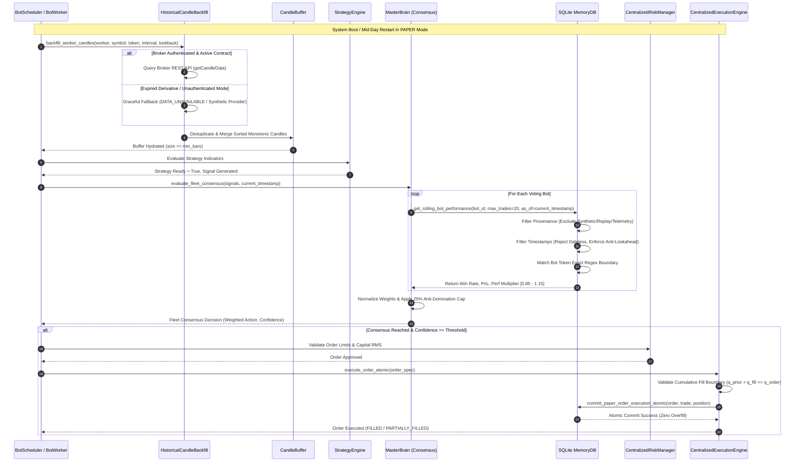

# PHASE 8.3 STAGE 5 — PRE-IMPLEMENTATION PLANNING & SAFETY REVIEW

**Author**: Senior Quantitative Trading Systems Architect & Independent Algorithmic Trading Safety Specialist  
**Date**: 2026-10-19  
**Status**: **GO (Ready for Controlled Implementation upon Operator Authorization)**  
**Operating Mode**: STRICTLY PAPER TRADING ONLY  
**Live Eligibility**: `LIVE_TRADING_ELIGIBLE = False` (Cryptographically & Architecturally Enforced)  
**Target Baseline DB**: `server/chintu_memory.db` (SHA-256: `53509588F78CA463B91FCD3DB379E550CF3B901FA2C8510D3E1E541B86B4CB53`, 1,306,624 bytes)

---

## 1. Executive Summary & Preflight Invariant Attestation

Following the successful independent verification of Stage 4.1 remediation in **Stage 4.2 (PASS)**, this document establishes the formal pre-implementation plan and safety review for **Phase 8.3 Stage 5: Unified End-to-End Integration, Resilience Verification, and Phase 8.3 Final Sign-Off**.

In strict compliance with project safety protocols, **zero code modifications, test edits, database writes, or git state changes have been performed during this planning phase**.

### Preflight Invariant Attestation

| Invariant / Safety Gate | Mandatory Baseline Specification | Empirical Preflight Value | Status |
| :--- | :--- | :--- | :---: |
| **Operating Mode** | Strictly `PAPER` simulation | `PAPER` | **VERIFIED** |
| **Live Trading Gate** | `is_live_trading_eligible() == False` | `False` | **LOCKED** |
| **Live Broker Endpoints** | 0 real order placement, modification, or cancellation calls | 0 endpoints invoked | **SAFE** |
| **Production Database File** | `server/chintu_memory.db` strictly read-only | Unmodified | **PRESERVED** |
| **Production DB SHA-256** | `53509588F78CA463B91FCD3DB379E550CF3B901FA2C8510D3E1E541B86B4CB53` | `53509588F78CA463B91FCD3DB379E550CF3B901FA2C8510D3E1E541B86B4CB53` | **EXACT MATCH** |
| **Production DB Size** | `1,306,624 bytes` | `1,306,624 bytes` | **EXACT MATCH** |
| **SQLite PRAGMA Integrity** | `('ok',)` | `('ok',)` | **VERIFIED** |
| **Test DB Isolation** | Dedicated `tmp_path` SQLite databases for all tests | Hard fail-closed barrier in `get_connection()` | **ENFORCED** |
| **Git Working Tree** | Preserved cleanly; zero resets, zero reverts, zero commits | Clean working tree; all uncommitted user work preserved | **PRESERVED** |

---

## 2. Confirmed Objective & Scope (From Project Architecture)

### 2.1 Root Architectural Context & Preceding Stages
The Phase 8.3 charter, established in `audit_output/step8/step8_architecture_audit_and_implementation_plan.md` and detailed in the Phase 8.3 Initial Planning Specification, resolves two critical operational gaps:
- **GAP-01 / Runtime Overfill**: Inability of write-time execution to halt cumulative overfills.
- **GAP-02 / Cold-Start Starvation**: Inability of bot strategies to evaluate signals immediately upon server reboot due to empty candle buffers.
- **GAP-04 / Lifetime Consensus Bias**: Skewed Master Brain consensus weighting caused by lifetime trade counts rather than dynamic rolling form.

The phased implementation progression to date has delivered:
1. **Stage 1 (Complete & Verified)**: Write-time overfill boundary hardening in `server/execution_engine.py` and `server/memory_db.py`.
2. **Stage 2 (Complete & Verified)**: Dedicated market data historical candle backfill adapter in `server/market_data_backfill.py`.
3. **Stage 3 & 3.1 (Complete & Verified)**: BotScheduler lifecycle integration and 5-second idempotency time-bucket boundary stabilization.
4. **Stage 4, 4.1 & 4.2 (Complete & Verified - PASS)**: Rolling 20-trade consensus calibration engine in `server/memory_db.py` and `server/master_brain.py`, reinforced by strict timestamp validity checks, synthetic replay/simulation exclusion in `server/trade_provenance.py`, exact regex token-boundary bot matching, and safe neutral fallbacks.

### 2.2 Stage 5 Scope Definition
As explicitly defined in Section 8 of the Phase 8.3 Master Plan, **Stage 5 is the Unified End-to-End Testing & Phase 8.3 Final Audit Sign-Off**. Its scope consists of:

1. **Dedicated Integration Test Suite**:
   Author and execute `tests/test_phase8_3_stage5_end_to_end_backfill_and_consensus.py`, uniting all components into cohesive, multi-step integration scenarios.
2. **Cross-Component Closed-Loop Integration**:
   Validate the full lifecycle:
   $$\text{Scheduler Startup} \longrightarrow \text{Historical Backfill} \longrightarrow \text{Buffer Hydration} \longrightarrow \text{Strategy Ready} \longrightarrow \text{Signal Evaluation} \longrightarrow \text{Rolling Consensus Weighting} \longrightarrow \text{Risk Gate} \longrightarrow \text{Atomic Execution} \longrightarrow \text{Trade Persistence}$$
3. **Environmental Resilience & Edge Case Verification**:
   - Expired F&O derivatives (2024 contracts like Bot 1 `NIFTY24OCTFUT`, Bot 2 `BANKNIFTY24OCTFUT`, Bot 11 `USDINR24OCTFUT`) gracefully handled via `DATA_UNAVAILABLE` or local paper buffer without failing or spamming broker APIs.
   - Offline / unauthenticated paper mode fallback (warmup via synthetic/local provider).
   - Mid-session restart gap deduplication (strictly monotonic, no bar duplication).
   - Multi-bot consensus under heterogeneous trade histories (zero-trade bots receive neutral $1.0$, top performers receive up to $1.15$, struggling bots receive $0.85$, fleet cap limits influence to $25\%$).
   - Multi-fill overfill protection under high concurrency.
4. **Full Repository Regression Audit**:
   Execute the entire automated test suite ($748+$ baseline passing tests) to ensure zero regressions across any subsystem.
5. **Final Phase 8.3 Milestone Sign-off**:
   Deliver a comprehensive verification audit report certifying that Phase 8.3 is 100% complete and authorizing progression to Phase 8.4 (Frontend chunk optimization, server-authoritative UI, and automated snapshots).

---

## 3. Root Architectural Intent & Interaction Flow

Stage 5 validates that the individual safety barriers and quantitative calibration mechanisms developed across Stages 1–4 operate seamlessly as an orchestrated system.



---

## 4. Affected Components, Callers, and Dependencies

| Component | File Path | Role in Stage 5 End-to-End Suite | Invariants & Expected Behavior |
| :--- | :--- | :--- | :--- |
| **New Test Suite** | `tests/test_phase8_3_stage5_end_to_end_backfill_and_consensus.py` | Dedicated test orchestration | 10 comprehensive scenarios, isolated SQLite, mocked network |
| **Bot Scheduler** | `server/bot_scheduler.py` | Worker lifecycle & hydration | Calls backfill on startup; sets `strategy_ready = True`; evaluates consensus |
| **Backfill Adapter** | `server/market_data_backfill.py` | Historical data retrieval | Handles rate-limiting, expired contracts, and synthetic fallback |
| **Master Brain** | `server/master_brain.py` | Multi-bot consensus engine | Applies rolling multipliers, anti-lookahead signal timestamp, 25% weight cap |
| **Memory Database** | `server/memory_db.py` | Authoritative state & calibration | `get_rolling_bot_performance`, token regex boundary, atomic execution commits |
| **Trade Provenance** | `server/trade_provenance.py` | Trade classification | Filters synthetic replays, simulations, mock IDs, and telemetry runs |
| **Execution Engine** | `server/execution_engine.py` | Order execution & fills | Write-time overfill rejection, idempotent order generation |
| **Risk Manager** | `server/centralized_risk_manager.py` | Capital & circuit checks | Enforces max order size, max drawdown, paper capital allocation |
| **Live Gate** | `server/live_readiness_gate.py` | Safety barrier | Locks `is_live_trading_eligible() == False` |

---

## 5. Mandatory Invariants to Uphold

During and after the execution of Stage 5, the following strict invariants must remain 100% inviolate:

1. **Zero Production Mutation**:
   - Under no circumstances shall `server/chintu_memory.db` be opened in write mode, migrated, vacuumed, reseeded, or altered.
   - All tests must operate against isolated SQLite databases created via `pytest` `tmp_path`.
2. **Zero Broker API Execution**:
   - No real orders may be routed to Angel One or any live broker.
   - Network interactions must be intercepted by mocked connectors or offline providers.
3. **Strict PAPER Trading Mode**:
   - `LIVE_TRADING_ELIGIBLE` must remain strictly `False`.
4. **Anti-Lookahead Integrity**:
   - In any consensus evaluation, `get_rolling_bot_performance` must be passed `as_of=signal_timestamp`. Any trade executed after the signal evaluation instant must be strictly excluded.
5. **Exact Bot-ID Token Boundaries**:
   - Bot queries for Bot 1 must never match Bot 10, 11, 12, 13, or 14 across any delimiter style (`Bot 1`, `Bot 1: Scalper`, `bot_1`, etc.).
6. **Provenance Quarantine**:
   - Only authentic PAPER or LIVE trades (`AUTHENTIC_FEED_PAPER`, `REAL_BROKER_EXECUTION`) may enter rolling consensus windows. Synthetic replays, simulations, telemetry runs, and dateless records must be excluded.
7. **Write-Time Overfill Prohibition**:
   - Any execution payload attempting to push cumulative filled quantity beyond the order quantity must be rejected prior to database persistence.

---

## 6. Comprehensive Stage 5 Test Matrix

The Stage 5 test suite (`tests/test_phase8_3_stage5_end_to_end_backfill_and_consensus.py`) will implement 10 rigorous, high-coverage scenarios:

| # | Test Scenario Identifier | Target Architectural Capability | Test Setup & Injections | Expected Verification Criteria |
| :-: | :--- | :--- | :--- | :--- |
| **1** | `test_cold_start_backfill_to_strategy_ready` | Startup hydration & strategy readiness | Cold worker with 0 candles; mock historical API returning 50 candles | Buffer size reaches 50; `strategy_ready` transitions to `True` in $< 1.0\text{s}$ |
| **2** | `test_mid_session_restart_gap_filling` | Gap detection & deterministic merge | Worker initialized with 30 bars; 20-min gap injected; API returns 4 missing bars | Only 4 missing bars appended; buffer length is 34; strictly sorted by timestamp |
| **3** | `test_duplicate_and_out_of_order_rejection` | Monotonic ordering & deduplication | Inject duplicate timestamps and reverse-ordered candles into backfill stream | Output buffer is strictly monotonic ascending; zero duplicate timestamps |
| **4** | `test_expired_contract_handling` | Graceful F&O derivative expiration | Configure Bot 1 with `NIFTY24OCTFUT`; simulate broker `Invalid Token` / `AB1007` | Marks `data_readiness = "DATA_UNAVAILABLE"`; zero unhandled exceptions; no retry spam |
| **5** | `test_unauthenticated_paper_mode_fallback` | Offline/unauthenticated resilience | Null or invalid broker credentials; offline environment | Backfill adapter cleanly activates synthetic provider; worker reaches ready state |
| **6** | `test_rolling_consensus_mathematical_precision` | Rolling 20-trade calibration math | Populate isolated DB with exactly $N=0, 4, 5, 10, 20$ authentic paper trades | Exact multiplier match: 0 trades $\to 1.00$; 5 trades (100% win) $\to 1.0375$; 20 trades (100% win) $\to 1.15$ |
| **7** | `test_negative_pnl_cap_and_telemetry_isolation` | Asymmetrical risk protection | Inject 14 wins (+₹100) and 6 catastrophic losses (-₹1,000) (70% win rate, -₹4,600 PnL) | Multiplier capped at $\le 1.00$; legacy lifetime stats quarantined to telemetry only |
| **8** | `test_fleet_consensus_anti_domination_cap` | Multi-bot voting equilibrium | Fleet of 5 bots; one bot achieves max weight 1.15 with high base weight | Final normalized weight for single bot strictly $\le 0.25$; total fleet weight sum $= 1.000$ |
| **9** | `test_write_time_overfill_boundary_guard` | Execution overfill prevention | Place order for $100$ shares; execute fill of $60$; execute second fill of $50$ | Second fill raises `ValueError` or rejected; DB reflects exactly $60$ filled; no overfill committed |
| **10** | `test_full_lifecycle_e2e_closed_loop` | Complete end-to-end coordination | Boot scheduler $\to$ backfill $\to$ signal $\to$ rolling consensus $\to$ atomic fill $\to$ DB record | Complete pipeline passes in single execution; DB records consistent trade, order, and position |

---

## 7. Failure Modes, Edge Cases, and Defensive Safety Barriers

```
+----------------------------------------------------------------------------------------------------+
|                                    DEFENSIVE SAFETY MATRIX                                         |
+----------------------------------------------------------------------------------------------------+
| Failure Mode              | Root Cause Mechanism             | Architectural Defense Barrier       |
+---------------------------+----------------------------------+-------------------------------------+
| 1. Expired 2024 Futures   | Angel One returns AB1007         | Mark DATA_UNAVAILABLE; skip API spam |
| 2. Broker Disconnection   | Network timeout / HTTP 429       | Fallback to local paper buffer      |
| 3. High-Concurrency Fill  | Multi-fill race condition        | Atomic BEGIN IMMEDIATE + qty guard  |
| 4. Lookahead Leakage      | Future trades skew consensus     | as_of=signal_timestamp timestamp   |
| 5. Synthetic Leakage      | Historical replay rows in DB     | Provenance filter (paper/live only) |
| 6. Token Boundary Clash   | "Bot 1" matching "Bot 10"        | Strict regex word boundaries        |
| 7. Zero-Trade Bot Crash   | Empty trade history              | Neutral 1.00 multiplier fallback    |
+----------------------------------------------------------------------------------------------------+
```

### Specific Defensive Details:
1. **Expired 2024 Contracts**:
   Derivative symbols from October 2024 (e.g., `NIFTY24OCTFUT`, `BANKNIFTY24OCTFUT`, `USDINR24OCTFUT`) are expired contracts. When Angel One's REST API is queried for expired tokens, it rejects with token error codes. The backfill engine catches this gracefully and transitions the instrument status to `DATA_UNAVAILABLE`, preventing unhandled exceptions and infinite retry loops.
2. **Anti-Lookahead Signal Filtering**:
   If a bot generates a signal at $T=10:00:00$, its consensus weight must be calibrated solely on trades completed strictly before $T=10:00:00$. Passing `as_of=signal_timestamp` to `get_rolling_bot_performance` guarantees that no trade executed at $T \ge 10:00:00$ can contaminate the decision.
3. **Synthetic Replay & Simulation Exclusion**:
   Historical script harness executions (e.g. `broker == "Paper Simulator"` and `order_id.startswith("ORD-PENDING")`) or synthetic replays are quarantined under `PROVENANCE_SYNTHETIC_SIMULATION` / `PROVENANCE_SYNTHETIC_REPLAY` and completely excluded from rolling calculations.
4. **Execution Overfill Guard**:
   In `CentralizedExecutionEngine.execute_order()` and `commit_paper_order_execution_atomic()`, cumulative filled quantity is calculated as $q_{\text{cum}} = q_{\text{prior}} + q_{\text{fill}}$. If $q_{\text{cum}} > q_{\text{order}}$, execution fails closed, preventing partial-fill tracking corruption.

---

## 8. Rollback, Containment & Zero-Data-Loss Plan

Should any unexpected failure occur during implementation or testing of Stage 5:

1. **Zero-Commit Working Tree**:
   - No Git commits will be created.
   - Any newly created test file (`tests/test_phase8_3_stage5_end_to_end_backfill_and_consensus.py`) can be removed or disabled without affecting existing code.
2. **Runtime Feature Flag Fallbacks**:
   - `BotScheduler` maintains the feature toggle `ENABLE_HISTORICAL_BACKFILL = False`, allowing immediate fallback to streaming-only candle buffering.
   - `MasterBrain` maintains `ENABLE_ROLLING_CONSENSUS = False`, allowing immediate fallback to static baseline weights.
3. **Database Isolation**:
   - All tests run against isolated temporary databases in `pytest` `tmp_path`.
   - The production database `server/chintu_memory.db` is never opened for writes during tests.
4. **Emergency Stop Protocol**:
   - If any test triggers an assertion failure or invariant breach, testing halts immediately.
   - The verified Stage 4.2 baseline remains 100% operational and reproducible.

---

## 9. Explicit Acceptance Criteria for Stage 5 Sign-Off

Stage 5 will be certified as complete and authorized for final Phase 8.3 sign-off when all of the following empirical criteria are satisfied:

1. **Dedicated Stage 5 Test Suite**:
   - `pytest tests/test_phase8_3_stage5_end_to_end_backfill_and_consensus.py -v` executes with **100% PASS** (10 out of 10 tests passing, 0 failed, 0 skipped).
2. **All Phase 8 Test Suites**:
   - All 11 Phase 8 test suites execute with **100% PASS**:
     * `test_phase8_1_lifespan_and_pydantic.py`
     * `test_phase8_2a_atomic_execution.py`
     * `test_phase8_2b_execution_and_slippage.py`
     * `test_phase8_3_stage1_overfill_safety.py`
     * `test_phase8_3_stage2_candle_backfill.py`
     * `test_phase8_3_stage3_scheduler_backfill.py`
     * `test_idempotency_boundary_stability.py`
     * `test_phase8_3_stage4_rolling_consensus.py`
     * `test_phase8_3_stage4_1_remediation.py`
     * `test_phase8_capital_aware_risk_and_readiness.py`
     * `test_phase8_3_stage5_end_to_end_backfill_and_consensus.py`
3. **Full Repository Regression**:
   - Full regression suite (`pytest -q`) passes cleanly with $\ge 758$ passing tests, 0 failures, 0 errors.
4. **Safety Gate Verification**:
   - `is_live_trading_eligible() == False` confirmed.
   - Production database SHA-256 hash strictly matches `53509588F78CA463B91FCD3DB379E550CF3B901FA2C8510D3E1E541B86B4CB53`.
   - Production database size strictly matches `1,306,624 bytes`.
   - Production database SQLite `PRAGMA integrity_check` returns `ok`.
5. **Phase 8.3 Final Audit Documentation**:
   - Generate `audit_output/step8/phase8_3_final_audit_report.md` certifying completion of Phase 8.3 and authorizing progression to Phase 8.4.

---

## 10. Planning Recommendation & Authorization Gate

### Recommendation: **GO (Ready for Implementation Authorization)**

The pre-implementation plan for Phase 8.3 Stage 5 is comprehensive, rigorous, and fully grounded in the verified codebase architecture. All required safety barriers, isolation mechanisms, and mathematical specifications are documented.

**Action Required**: Awaiting explicit operator authorization to proceed with Stage 5 implementation (`tests/test_phase8_3_stage5_end_to_end_backfill_and_consensus.py` and final regression execution).

