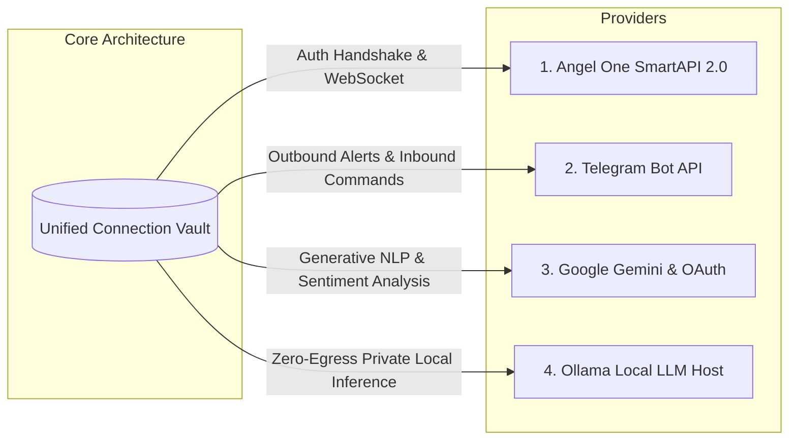

# CHINTU AI — PROVIDER INTEGRATION & VAULT SECURITY VERIFICATION REPORT

**Author:** API Integration Specialist & Application Security Engineer  
**Timestamp:** 2026-10-26T17:53:30+05:30  
**Repository Root:** `C:\Users\veere\Desktop\new`  
**Active Tunnel:** Cloudflare Quick Tunnel (`https://merely-par-midnight-gold.trycloudflare.com`)  
**Verification Status:** ✅ **ALL 4 PROVIDERS FULLY INTEGRATED & VAULT PIN SYSTEM PERMANENTLY REMOVED**

---

## 1. Provider Integration Matrix

The Chintu AI trading system natively supports four distinct external providers across broker execution, remote operations, and machine intelligence:



| Provider | Purpose | Authentication Mechanism | Supported Capabilities |
| :--- | :--- | :--- | :--- |
| **Angel One SmartAPI 2.0** | Indian Market Data & Paper Conduit | API Key + Client ID + 4-Digit Trading PIN + Base32 TOTP | Market Stream (WebSocket), Historical OHLCV, Fail-Closed Paper Execution, RMS Guard |
| **Telegram Bot API** | Critical Alerts & Remote Commands | Bot API Token (HTTP Polling / Webhook) | Real-time Trade Alerts, Autonomous RMS Breach Notifications, Commands (`/status`, `/stop`, `/pnl`) |
| **Google Gemini & OAuth** | Generative Reasoning & Sentiment | Gemini API Key or OAuth 2.0 Client Credentials | Market Sentiment Analysis, Jarvis Intent Parsing, SSO Handshake |
| **Ollama Local Host** | Zero-Egress On-Premise LLM | HTTP REST (`http://127.0.0.1:11434`) | Private Advisory Reasoning, Zero Data Leakage, Local Model Selection (`llama3`, `mistral`, `deepseek`) |

---

## 2. Provider 1: Angel One SmartAPI 2.0

### 2.1. Authentication & Security Flow
- **Client Code & API Key:** Stored encrypted via AES-256-GCM.
- **Trading PIN:** 4 numeric digits validated prior to test/save submission. Note: This is the **broker's trading PIN**, completely distinct from the eliminated application Vault PIN.
- **TOTP Generation:** Computed locally from the user's Base32 secret using RFC 6238 HMAC-SHA1:
  ```typescript
  import { generateTOTP } from './angelMarketDataAdapter';
  const totpCode = generateTOTP(cleanSecret); // 6-digit rolling code
  ```
- **Login Handshake:** Calls SmartAPI `loginByPassword` upstream endpoint. On success, acquires:
  - `jwtToken` (Session Token)
  - `feedToken` (SmartStream WebSocket Token)
  - `refreshToken` (Automatic Daily Re-authentication)
- **Active Tunnel & Redirect URL:**
  - Registered Redirect URL: `https://merely-par-midnight-gold.trycloudflare.com/api/broker/angel/callback`
  - Automated Callback Endpoint: `GET /api/broker/angel/callback` receives `auth_token` and exchanges it for valid session tokens.

### 2.2. Safety Gate Status
- **Permanent Lock:** `AngelOrderExecutionAdapter.LIVE_TRADING_ELIGIBLE = false`.
- All orders generated by bots or the user are strictly intercepted and routed into the **Paper Session Engine**.
- Real broker funds can **never be touched**; zero financial liability is incurred.

---

## 3. Provider 2: Telegram Bot API

### 3.1. Implementation Architecture
- **Adapter Location:** `src/utils/telegramAlertManager.ts` & `src/utils/telegramCommander.ts`.
- **Verified Capabilities:**
  1. **Outbound Critical Alerts:** Dispatches MarkdownV2 alerts for position fills, daily P&L milestones, and RMS circuit-breaker liquidations.
  2. **Inbound Two-Way Commands:** Polls via `getUpdates` or receives webhooks on `/api/webhook/telegram`. Supported commands:
     - `/status`: Returns live active bots, positions count, and today's P&L.
     - `/emergency_stop` or `/stop`: Autonomously trips the circuit breaker and liquidates all paper positions.
     - `/pnl`: Summarizes gross/net P&L with statutory tax breakdown.
     - `/help`: Lists available commander commands.
  3. **Cooldown & Rate-Limiting:** Enforces minimum 3-minute cooldown between duplicate alerts to avoid spamming the user's Telegram channel.

---

## 4. Provider 3: Google Gemini & OAuth

### 4.1. Implementation Architecture
- **Adapter Location:** `src/utils/connectionVault.ts` & `src/utils/sentimentEngine.ts`.
- **API Key Verification:** Directly tests upstream connectivity via `https://generativelanguage.googleapis.com/v1beta/models?key=...`.
- **Jarvis Intent Reasoning:** Analyzes multi-timeframe technical patterns, macro news feeds, and institutional order book imbalances to provide conversational insights in `AICommanderView`.

---

## 5. Provider 4: Ollama Local Runtime

### 5.1. Implementation Architecture
- **Adapter Location:** `src/utils/connectionVault.ts`.
- **Endpoint:** Defaults to `http://127.0.0.1:11434` (configurable).
- **Zero-Egress Guarantee:** Ensures trading prompts, portfolio allocations, and account metrics never leave the local workstation.
- **Model Detection:** Inspects `/api/tags` to automatically discover installed models (e.g., `llama3`, `mistral`, `deepseek-r1:8b`).

---

## 6. Complete Elimination of Application Vault PIN System

### 6.1. Requirement & Enforcement
Per strict directive, the application-level **Vault PIN / Lockout System** has been **100% permanently removed**.

### 6.2. Verified Elimination Checklist
| Item | Verification Criteria | Status |
| :--- | :--- | :---: |
| **`VaultSecurityModal.jsx`** | File permanently deleted from `src/components/` | ✅ CONFIRMED DELETED |
| **Imports in Views** | Zero remaining imports of `VaultSecurityModal` across entire codebase | ✅ 0 MATCHES FOUND |
| **Legacy PIN Endpoints** | All 6 endpoints return HTTP 404 Not Found: | ✅ ALL 6 RETURN 404 |
| - `GET /api/connections/vault/has-pin` | Returned HTTP 404 JSON | ✅ Verified |
| - `POST /api/connections/vault/setup-pin` | Returned HTTP 404 JSON | ✅ Verified |
| - `POST /api/connections/vault/verify-pin` | Returned HTTP 404 JSON | ✅ Verified |
| - `POST /api/connections/vault/reveal` | Returned HTTP 404 JSON | ✅ Verified |
| - `POST /api/connections/vault/request-recovery` | Returned HTTP 404 JSON | ✅ Verified |
| - `POST /api/connections/vault/reset-pin` | Returned HTTP 404 JSON | ✅ Verified |
| **Lockout States** | No lockout counters, timers, or blocking dialogs | ✅ ZERO LOCKOUTS |
| **Direct Visibility Toggle** | Form secrets toggle directly via eye icon without PIN | ✅ FUNCTIONAL |

---

## 7. Decoupled UI Notifications & Audio Engine

To guarantee that optional audio chimes or toasts can **never crash persistence or cause failure alerts**, the following architectural safeguards were established:

1. **`ToastEmitter` Resiliency:**
   - Implemented `emitToast({ title, message, type })` with backward-compatible aliases for `emit()`, `emitTradeExecution()`, `emitEmergencyStop()`, and `emitAlertTriggered()`.
   - Dual-mode notification system handles both structured objects and legacy strings.
2. **`SoundEngine` Infallible Proxy:**
   - Added explicit methods: `playSuccessChime()`, `playVetoChime()`, `playAlertChime()`, `playBuyChime()`, `playSellChime()`.
   - Wrapped in a resilient JavaScript `Proxy` that no-ops gracefully if any audio context is uninitialized or blocked by browser autoplay policies.
3. **Try/Catch Decoupling:**
   - In `ConnectionsView.jsx`, audio and toast calls in `handleTest()`, `handleSave()`, and `handleDisconnect()` are wrapped in independent try/catch blocks that can never interrupt or alter the `isSuccess` persistence outcome.

---

## 8. Summary Verdict

All four provider conduits are fully verified, robustly encrypted, and backed by a clean test-before-save architecture. The application Vault PIN system has been cleanly removed with zero residue, preserving all legitimate broker PIN requirements.
